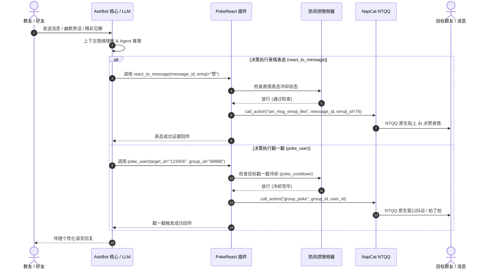
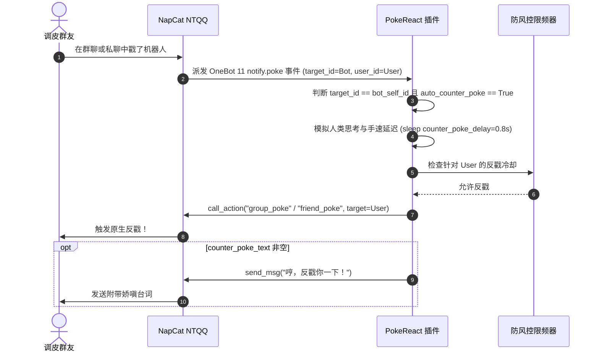

<div align="center">

# 🎯 QQ 原生戳一戳与表情表态工具箱
### astrbot_plugin_qq_poke_react

**基于 OneBot 11 与 NapCat NTQQ 的原生戳一戳、消息表情表态、拟人化反戳与双 LLM 工具箱**

[](https://github.com/Soulter/AstrBot)
[](https://github.com/NapNeko/NapCatQQ)
[](https://github.com/Soulter/AstrBot)
[](LICENSE)
[](https://github.com/zjj1280637679-ship-it/astrbot_plugin_qq_poke_react)

</div>

---

## 📖 简介 / Introduction

`astrbot_plugin_qq_poke_react` 是一款专为 **AstrBot** 与 **NapCat (NTQQ)** 量身定制的深层互动交互插件。通过底层无缝桥接 OneBot 11 扩展协议，使机器人能够像真实真人一样：
- **物理戳一戳**：在群聊与私聊中原生触发真实窗口抖动与“拍了拍”物理戳一戳；
- **消息表情点赞表态 (Emoji Like)**：对群友精彩发言、幽默梗图快速贴上生动贴切的表情表态（👍 点赞、😂 大笑、🌹 玫瑰、❤️ 爱心、🤡 打脸等）；
- **被戳拟人化反戳 (Auto Counter-Poke)**：群友戳机器人时，机器人能够感知并执行拟人化延迟反击与个性化台词互动；
- **大模型双函数工具 (LLM Tool Calling)**：将“戳人”与“贴表情”封装为第一公民级别的 Agent 工具，由大模型根据聊天氛围自主决策、情境化调用；
- **防风控滑动窗口限频**：内置毫秒级限频器与管理员白名单特权沙箱，保障高频互动下的账号安全。

---

## 🔄 核心交互时序图 / Architecture & Workflow

### 1. 大模型自主表情表态与戳人流程 (LLM Tool Flow)


### 2. 被动被戳自动拟人化反戳流程 (Auto Counter-Poke Flow)


---

## 🎨 常见 NTQQ 表情别名映射对照表 / Emoji Alias Reference

插件内置智能表情解析器，自动支持输入 **中文名称**、**Unicode Emoji** 以及 **QQ 原生 Face ID**，常见映射如下：

| 表情效果 | 常用中文别名 | 支持的 Emoji | emoji_id | 常见使用场景 |
| :---: | :---: | :---: | :---: | :---: |
| 👍 | `赞` / `点赞` / `强` / `like` | 👍 | `76` | 赞同观点、认可发言 |
| 👌 | `ok` / `好的` / `没问题` / `可以` | 👌 | `124` | 确认、同意 |
| ❤️ | `爱心` / `心` / `喜欢` / `heart` | ❤️ / 💖 | `66` | 表达喜爱、友好互动 |
| 😂 | `笑哭` / `笑死` / `joy` | 😂 | `182` | 搞笑段子、欢乐聊天 |
| 🐮 | `666` / `牛` / `牛啊` / `给力` | 🤙 | `299` | 膜拜大佬、精彩操作 |
| 🎉 | `庆祝` / `喝彩` / `恭喜` / `好耶` | 🎉 / 🎊 | `144` | 报喜、欢庆 |
| 🌹 | `玫瑰` / `鲜花` / `rose` | 🌹 | `63` | 感谢、致意 |
| 👏 | `鼓掌` / `拍手` / `clap` | 👏 | `99` | 精彩表演、掌声欢迎 |
| 🙏 | `拜托` / `拜谢` / `感谢` / `祈祷` | 🙏 | `297` | 请求、致谢 |
| 🤜 | `抱拳` / `承让` / `多谢` | 🤜 | `118` | 江湖致意 |
| 💔 | `心碎` / `伤心` / `叹气` | 💔 | `67` | 共情、难过 |
| 💩 | `便便` / `屎` / `poop` | 💩 | `59` | 玩梗调侃 |
| ❓ | `疑问` / `问号` / `迷惑` | ❓ | `32` | 疑惑 |
| 🐶 | `doge` / `狗头` / `滑稽` | 🐶 | `179` | 调侃、保命 |
| 🔥 | `火` / `火热` / `fire` | 🔥 | `128293` | 热烈气氛（Unicode 表态） |

> 💡 **ID 规则**（与 NapCat 源码 `setEmojiLike` 一致）：`emoji_id` 长度 ≤ 3 视为 QQ 系统表情（emoji_type=1）；长度 > 3 视为 Unicode 表情的十进制码点（emoji_type=2）。未收录的单个 Unicode 表情会自动转换为码点；纯数字直接透传；完全无法识别的输入会返回带候选建议的错误提示，不会静默替换为其他表情。

---

## 🛠️ 大模型工具函数契约 / LLM Tools Contract

大模型在启用本插件后，将自动注册两个核心工具：

### 1. `poke_user`
- **函数名**: `poke_user`
- **功能描述**: 原生戳指定群友或私聊好友一戳（支持群聊与私聊）。
- **参数规格**:
  - `target_id` (str, 必填): 目标用户的 QQ 号。
  - `group_id` (str, 选填): 群聊群号；若在私聊中或未提供则由系统根据当前会话自适应补全。
- **返回值**: 字符串描述调用成功或处于冷却限制的提示信息。

### 2. `react_to_message`
- **函数名**: `react_to_message`
- **功能描述**: 对指定消息贴表情（点赞、表态、贴表情包 Emoji 等）。
- **参数规格**:
  - `message_id` (str, 必填): 需要贴表情的目标消息 ID。
  - `emoji_id` (str, 必填): 表情名称（如 "赞"、"大笑"、"抱拳"）、Emoji 字符（如 "👍"、"😂"）或 QQ 原生数字代码。
- **返回值**: 字符串描述表情表态结果或错误详情。

---

## 💬 聊天指令用法 / Chat Commands

| 指令格式 | 说明 | 示例 |
| :--- | :--- | :--- |
| `/poke [@群友 / QQ号]` | 物理戳指定群友；若省略目标则戳自己 | `/poke @张三`<br>`/poke 123456789`<br>`/poke` |
| `/react <表情/Emoji> [消息ID]` | 在回复群消息时表态，或直接携带消息 ID 表态 | 回复某消息后发送：`/react 赞`<br>直接发送：`/react 😂 100234` |

---

## ⚙️ 配置项说明 / Configuration Options

在 AstrBot 管理面板或 `_conf_schema.json` 中可对插件各项参数进行精细化调整：

| 配置键名 | 类型 | 默认值 | 取值范围 | 说明 |
| :--- | :---: | :---: | :---: | :--- |
| `poke_cooldown` | `int` | `3` | `1 ~ 30` | 戳一戳目标冷却时间（秒），防止针对同一个人短时间高频戳人触发风控 |
| `react_cooldown` | `int` | `1` | `1 ~ 10` | 表情表态冷却时间（秒），防止高频密集对大量消息进行表情点赞 |
| `auto_counter_poke` | `bool` | `true` | `true / false` | 拟人化自动反戳开关；有人戳机器人自身时是否执行反戳 |
| `counter_poke_delay` | `float` | `0.8` | `0.1 ~ 5.0` | 反戳延迟时间（秒），模拟真实人类看到并反手戳回去的动作反应手速 |
| `counter_poke_text` | `string` | `"哼，反戳你一下！"` | 任意文本 | 反戳时随附发送的台词（若留空则仅执行物理反戳，不发文字） |
| `admins_id` | `list` | `["2973338092"]` | QQ 号列表 | 管理员白名单；管理员享受无冷却限频、特权放行待遇 |

---

## 🚀 安装与启用 / Installation

### 方式一：AstrBot 插件市场安装 (推荐)
1. 打开 AstrBot Web 控制台；
2. 进入 **插件市场**，搜索 `QQ 原生戳一戳与表情表态工具箱` 或 `astrbot_plugin_qq_poke_react`；
3. 点击 **安装** 即可。

### 方式二：Git 仓库直接拉取
将本仓库克隆至 AstrBot 的插件目录：
```bash
cd AstrBot/data/plugins
git clone https://github.com/zjj1280637679-ship-it/astrbot_plugin_qq_poke_react.git
```
重启 AstrBot 后即可在后台看到并启用。

---

## 📄 许可证 / License

本项目采用 [MIT License](LICENSE) 开源授权。
